# Bestiary review gallery

[Merperson swimming and articulation](merperson-motion/index.html)

[Merperson redesign and swim review](merperson-redesign/index.html)

[Equine anatomy and grazing correction](equine-correction/README.md)

[Stage 1B structural review and clips](stage-1b/README.md)

[Stage 1 equine comparisons and movement clips](stage-1/README.md)

Each row shows one LOD 0 specimen after one simulated second in the indicated pose. All four orthographic views share one scale within a row. Framing varies between species so the owl and squid can both be inspected.

[Technical report](report.md) · [Recorded baselines](baselines.json) · [Download the standalone Creature Lab](../standalone.html)

## Giant Squid

Pose · Rest

| Front | Side | Three-quarter | Rear |
|---|---|---|---|
| [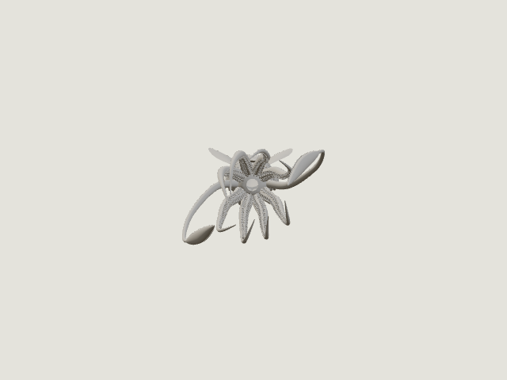](squid-front.png) | [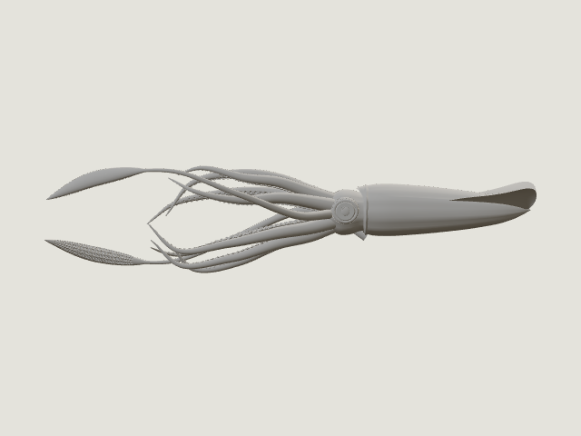](squid-side.png) | [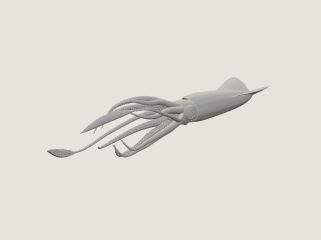](squid-three-quarter.png) | [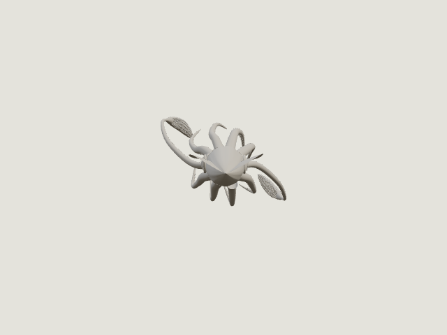](squid-rear.png) |

## Aragog

Pose · Idle

| Front | Side | Three-quarter | Rear |
|---|---|---|---|
| [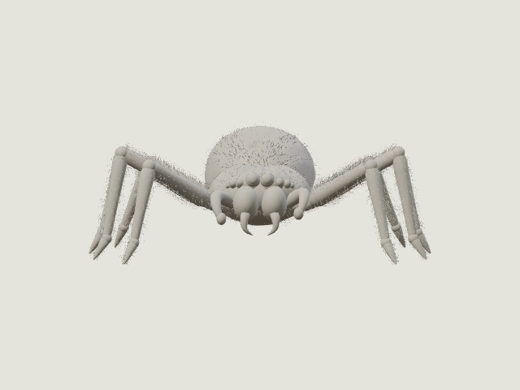](aragog-front.png) | [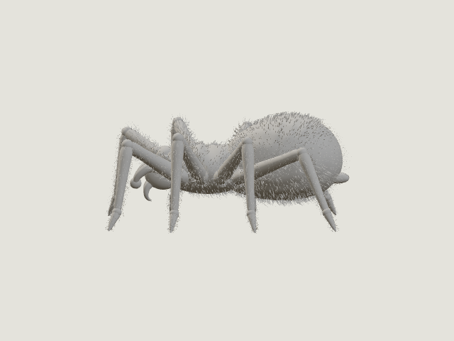](aragog-side.png) | [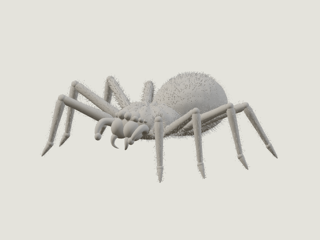](aragog-three-quarter.png) | [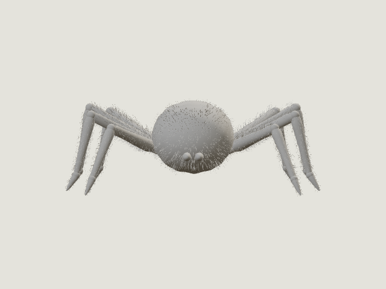](aragog-rear.png) |

## Centaur

Pose · Idle

| Front | Side | Three-quarter | Rear |
|---|---|---|---|
| [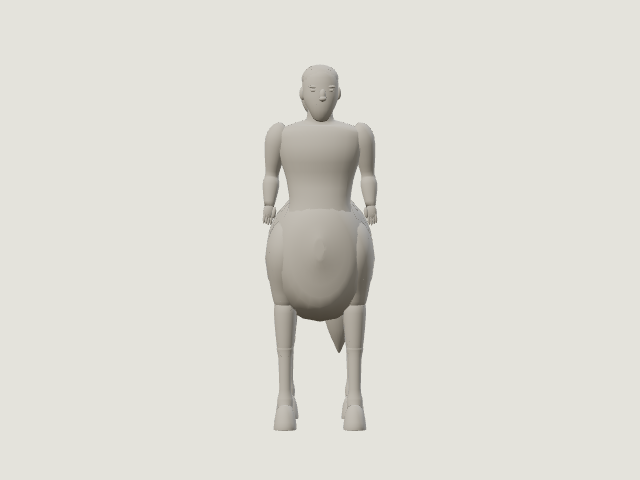](centaur-front.png) | [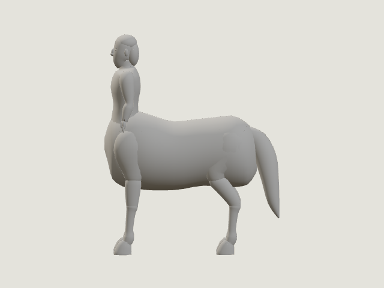](centaur-side.png) | [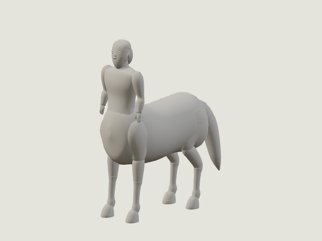](centaur-three-quarter.png) | [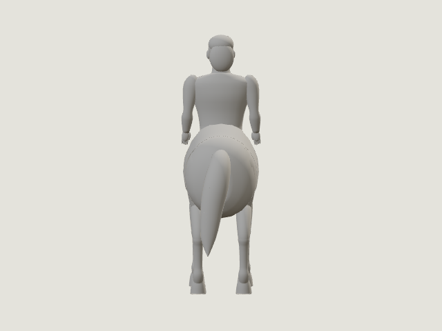](centaur-rear.png) |

## Unicorn

Pose · Idle

| Front | Side | Three-quarter | Rear |
|---|---|---|---|
| [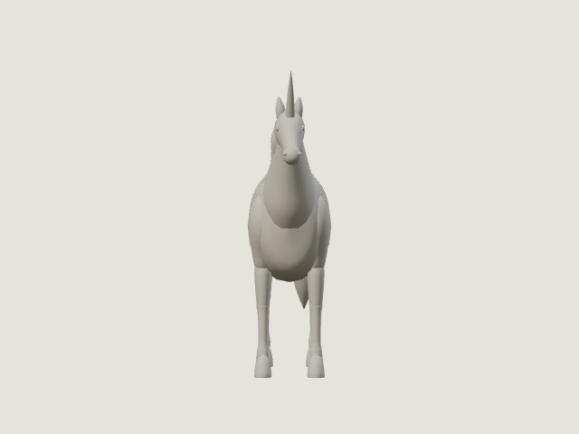](unicorn-front.png) | [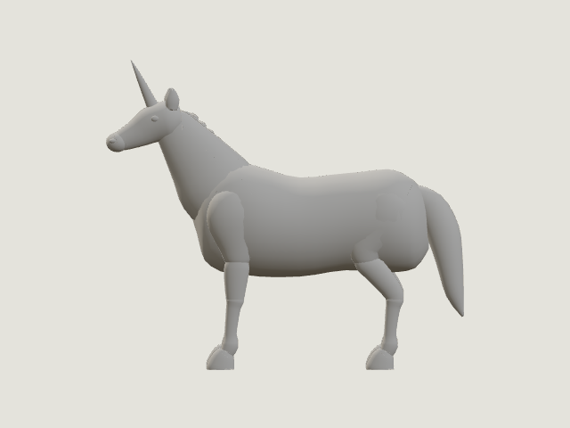](unicorn-side.png) | [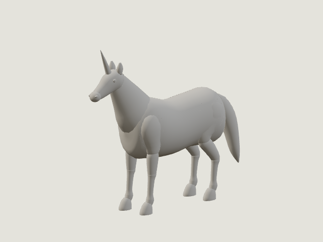](unicorn-three-quarter.png) | [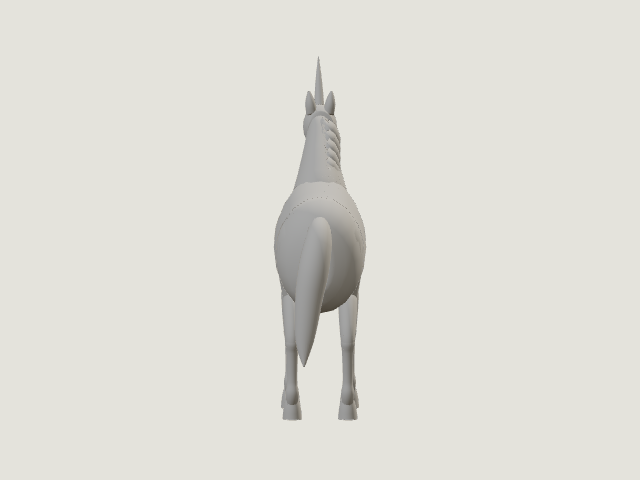](unicorn-rear.png) |

## Barn Owl

Pose · Perch

| Front | Side | Three-quarter | Rear |
|---|---|---|---|
| [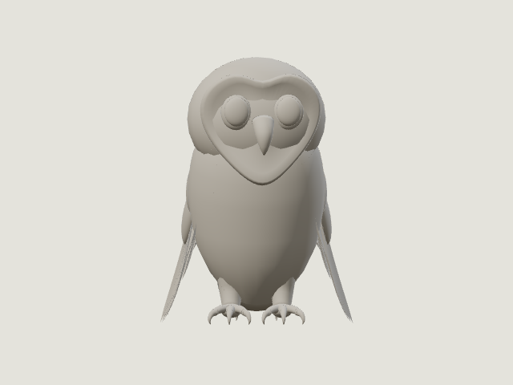](owl-front.png) | [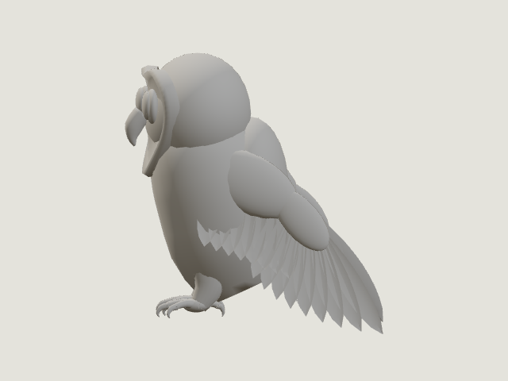](owl-side.png) | [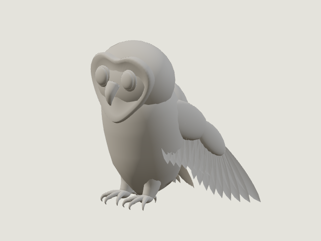](owl-three-quarter.png) | [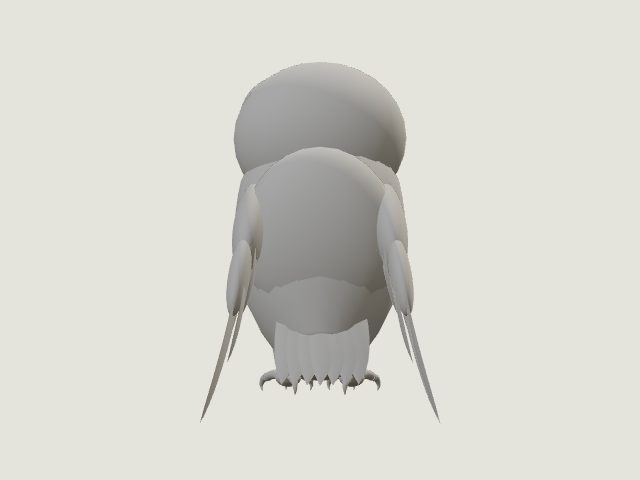](owl-rear.png) |

## Hippogriff

Pose · Unfold

| Front | Side | Three-quarter | Rear |
|---|---|---|---|
| [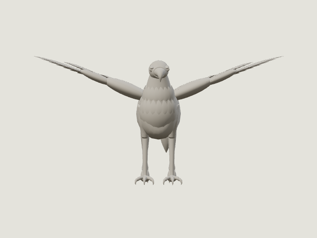](hippogriff-front.png) | [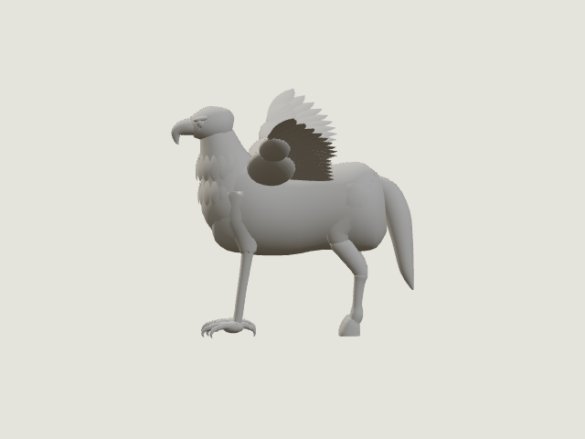](hippogriff-side.png) | [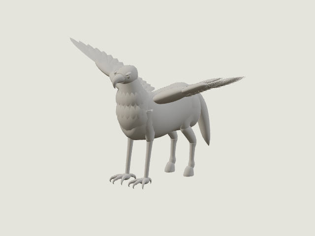](hippogriff-three-quarter.png) | [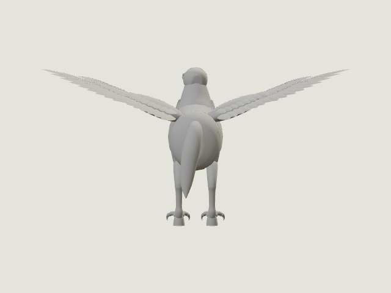](hippogriff-rear.png) |

## Merperson

Pose · Idle

| Front | Side | Three-quarter | Rear |
|---|---|---|---|
| [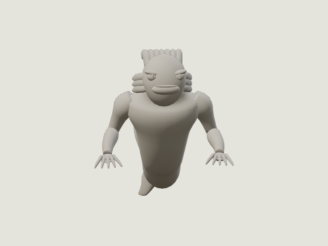](merperson-front.png) | [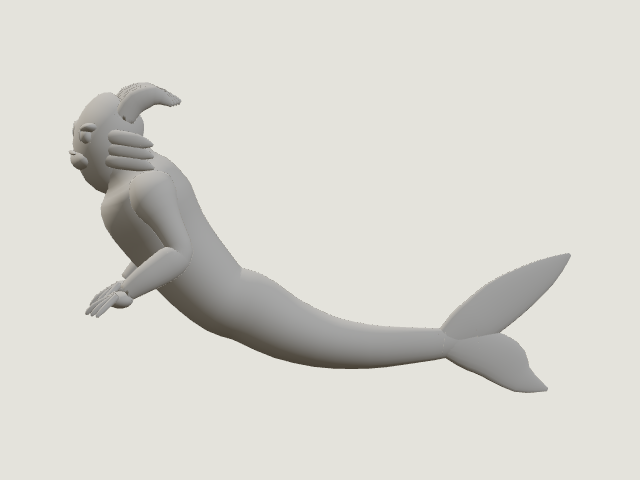](merperson-side.png) | [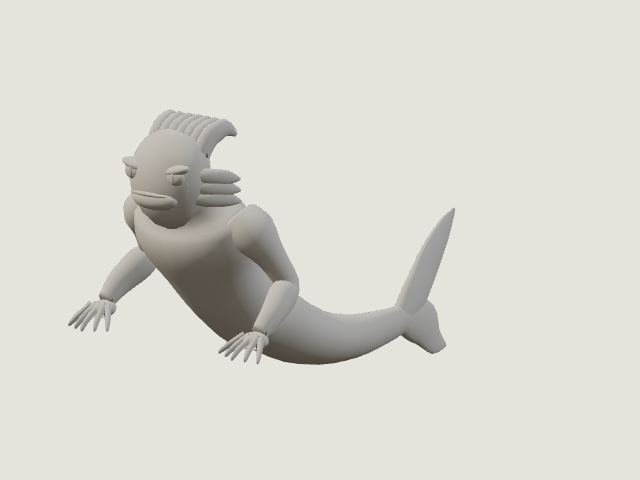](merperson-three-quarter.png) | [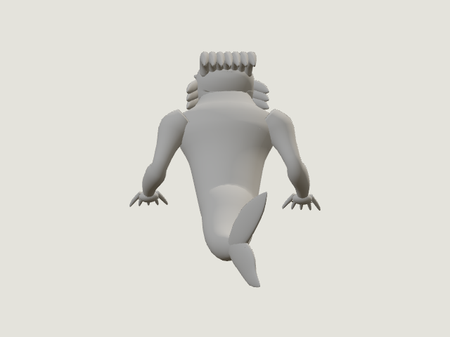](merperson-rear.png) |
